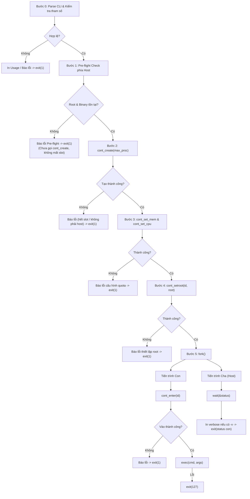

# Thiết Kế Chi Tiết Công Cụ CLI `container-run`

## 1. Tổng quan & Mục tiêu

`container-run` là công cụ tiện ích user-space chạy từ shell xv6 (trên container 0 / host), cho phép:
- Tạo mới và cấu hình giới hạn tài nguyên cho lightweight container (`cont_create`, `cont_setroot`, `cont_set_cpu`, `cont_set_mem`).
- Khởi chạy một chương trình cô lập bên trong container thông qua cơ chế `fork` và `cont_enter` an toàn.
- Hỗ trợ chạy tiếp chương trình trong container đã tạo sẵn (`-i`) và liệt kê trạng thái các slot container (`-l`) nhằm tối ưu hoá việc sử dụng 7 slot container của hệ thống.

---

## 2. Bối cảnh kỹ thuật & Ràng buộc Kernel xv6

Dựa trên mã nguồn hiện tại tại HEAD (sau khi đã tích hợp SCRUM-92 đến SCRUM-97):
1. **Root isolation (F1 fix):** Kernel đã từ chối `cont_enter()` nếu container chưa có root và từ chối `cont_setroot()` nếu container đã có tiến trình bên trong.
2. **Memory quota enforcement:** Kernel đã tích hợp kiểm tra số trang vật lý `pages_used` so với `max_pages` trong `vm.c`. Khi vượt ngưỡng, `growproc`, `vmfault`, `kfork`, `kexec` sẽ bị từ chối.
3. **CPU runtime quota:** Quản lý theo cơ chế soft quota chu kỳ `r_time()`. `cpu_quota_ticks = 0` được quy ước là **không giới hạn CPU** (`unlimited/no throttling`).
4. **PID Namespace:** Tiến trình đầu tiên vào container nhận virtual PID = 1. Khi tiến trình này kết thúc, namespace bị đóng.
5. **Giới hạn xv6:**
   - Tên binary tối đa 14 ký tự (`DIRSIZ` trong `fs.h`). `container-run` có độ dài 13 ký tự, hoàn toàn hợp lệ.
   - Số đối số tối đa `MAXARG = 32`.
   - Bảng `containers[]` có 8 slot (slot 0 là host, 1..7 cho container). Hệ thống **không có syscall `cont_destroy`**; mỗi container tạo ra sẽ chiếm 1 slot cho đến khi reboot.
   - Thao tác `cont_enter` là một chiều: tiến trình con sau khi vào container sẽ không thể quay về host và mất quyền quản trị. Tiến trình cha (shell host) **tuyệt đối không được gọi `cont_enter`**.

---

## 3. Giao diện Dòng lệnh (CLI Interface)

### 3.1. Cú pháp

1. **Tạo mới và khởi chạy:**
   ```text
   container-run [-p max_proc] [-c quota:period] [-m max_pages] [-v] <root> <cmd> [args...]
   ```

2. **Chạy trong container đang hoạt động:**
   ```text
   container-run -i <id> [-v] <cmd> [args...]
   ```

3. **Liệt kê trạng thái các container:**
   ```text
   container-run -l
   ```

### 3.2. Bảng tham số & Ràng buộc

| Cờ / Tham số | Kiểu / Định dạng | Giá trị mặc định | Ràng buộc & Mô tả |
|---|---|---|---|
| `-p <max_proc>` | Số nguyên | 0 (không giới hạn) | $max\_proc \ge 0$. Số tiến trình tối đa (bao gồm cả tiến trình khởi tạo). |
| `-c <quota>:<period>` | Cặp số nguyên cách nhau bởi dấu `:` | Không giới hạn | $period > 0, 0 \le quota \le period$. **Quy ước:** $quota = 0$ là hợp lệ và đại diện cho **không giới hạn CPU (unthrottled)** theo đúng logic kernel (`limit = 0`). |
| `-m <max_pages>` | Số nguyên | 0 (không giới hạn) | $max\_pages \ge 0$. Giới hạn số trang RAM vật lý (mỗi trang 4 KB). |
| `-v` | Cờ bật | Tắt | Verbose mode: in chi tiết ID, quota cấu hình và trạng thái container trước khi chạy và sau khi con thoát. |
| `-i <id>` | Số nguyên ($1 \le id \le 7$) | Không | Chạy tiếp trong container đã tạo sẵn. **Cấm kết hợp** với `-p`, `-c`, `-m` hoặc `<root>` (báo lỗi nếu dùng chung). |
| `-l` | Cờ độc lập | Không | In bảng trạng thái 8 slot container (0..7) bằng `cont_info` rồi thoát ngay. |
| `<root>` | Chuỗi đường dẫn | Bắt buộc (khi không dùng `-i` hay `-l`) | Đường dẫn thư mục root container trên host filesystem (ví dụ `/c1`). |
| `<cmd>` | Chuỗi đường dẫn | Bắt buộc (khi không dùng `-l`) | Đường dẫn chương trình tính từ root của container (ví dụ `/echo`, `/sh`). |
| `[args...]` | Danh sách chuỗi | Rỗng | Các đối số truyền nguyên bản cho chương trình con qua `exec`. |

---

## 4. Thứ tự An toàn Bắt buộc (0 – 6)

Để bảo đảm không rò rỉ quyền root host, không làm hỏng shell host và không lãng phí 7 slot container khi tham số sai, công cụ tuân thủ nghiêm ngặt quy trình:



### Chi tiết các bước:
- **Bước 0: Phân tích tham số thuần túy (không gọi syscall kernel):**
  - Kiểm tra cú pháp, parse số nguyên, kiểm tra $quota \le period$, kiểm tra số lượng đối số $\le MAXARG$.
- **Bước 1: Pre-flight check từ phía host:**
  - Dùng `open(root, O_RDONLY)` và `fstat` để đảm bảo `<root>` tồn tại và là thư mục (`T_DIR`).
  - Ghép chuỗi đường dẫn `<root>/<cmd>` và dùng `open` để kiểm tra binary tồn tại trên host trước khi cô lập. Nếu file không tồn tại hoặc không phải file thường (`T_FILE`), dừng ngay lập tức. **Không bao giờ gọi `cont_create` nếu pre-flight thất bại.**
- **Bước 2: Tạo container `cont_create(max_proc)`:**
  - Nhận về `id` ($1 \le id \le 7$). Nếu trả về -1, thông báo nguyên nhân (hết slot hoặc không có quyền host).
- **Bước 3: Cấu hình tài nguyên:**
  - Gọi `cont_set_mem(id, max_pages)` nếu có `-m`.
  - Gọi `cont_set_cpu(id, quota, period)` nếu có `-c`.
- **Bước 4: Thiết lập root `cont_setroot(id, root)`:**
  - Bảo đảm container root được khóa cố định **trước** khi bất kỳ tiến trình nào bước vào.
- **Bước 5: Khởi tạo tiến trình qua `fork()`:**
  - **Tiến trình con:**
    - Gọi `cont_enter(id)`. Nếu thất bại, in thông báo stderr và gọi `exit(1)`.
    - Gọi `exec(cmd, args)`. Nếu thất bại, in thông báo stderr và gọi `exit(127)`.
  - **Tiến trình cha (Host):**
    - **Tuyệt đối không gọi `cont_enter`**.
- **Bước 6: Thu hồi & Báo cáo:**
  - Tiến trình cha gọi `wait(&status)`.
  - Nếu có `-v`, gọi `cont_info` để in tài nguyên đã dùng (ticks CPU, số trang RAM).
  - Thoát với mã lỗi tương ứng trạng thái của tiến trình con.

---

## 5. Bảng Mã Thoát (Exit Codes) & Định Dạng Thông Báo

### 5.1. Bảng mã thoát

| Mã thoát | Ý nghĩa | Tình huống |
|---|---|---|
| `0` | Thành công | Tiến trình trong container chạy xong và `exit(0)`, hoặc lệnh `-l` in danh sách thành công. |
| `1` | Lỗi công cụ / CLI | Sai cú pháp, tham số không hợp lệ, pre-flight thất bại, syscall tạo/cấu hình container lỗi. |
| `127` | Lỗi lệnh con (`Command not found`) | `exec` trong tiến trình con thất bại. |
| `N` ($>0, \ne 127$) | Trạng thái của lệnh con | Khi tiến trình con gọi `exit(N)`. |

*Ghi chú:* Nếu tiến trình con bị kernel tiêu diệt (ví dụ bị kill bởi OOM quota hoặc namespace-init exit), `wait(&status)` trả về `-1`. Cha sẽ in thông báo `container-run: process terminated abnormally or killed` và trả về mã thoát `1`.

### 5.2. Định dạng thông báo
- Tất cả thông báo lỗi được xuất ra **stderr (`fd = 2`)** theo mẫu:
  `container-run: <bước / nguyên nhân lỗi>`
- Thông báo trạng thái (khi có `-v` hoặc tạo container thành công):
  `container-run: container <id> created (root: <root>, max_proc: <p>, cpu: <q>/<per>, mem: <m> pages)`
  `container-run: container <id> process exited with status <status>`

---

## 6. Xử lý Trường hợp Biên (Edge Cases)

1. **Chạy từ bên trong container:**
   - Tiến trình trong container gọi `cont_create` sẽ bị kernel từ chối (trả về -1 vì không phải host). Công cụ báo lỗi: `container-run: must be run from host container (container 0)`.
2. **Quota CPU $0:period$:**
   - Được chấp nhận là cấu hình "unlimited CPU" và gọi `cont_set_cpu(id, 0, period)` bình thường.
3. **Chuỗi đường dẫn có dấu `/` thừa (ví dụ `/c1/` và `/echo`):**
   - Bộ phận ghép chuỗi pre-flight xử lý chuẩn hóa để không tạo thành chuỗi lỗi như `/c1//echo`.
4. **Hết 7 slot container:**
   - `cont_create` trả về -1 $\rightarrow$ Báo `container-run: cannot create container: no free slots available (reboot required)`.
5. **Độc lập cờ `-i`:**
   - Khi truyền `-i <id>`, nếu kèm `-p`, `-c`, `-m` hoặc `<root>` $\rightarrow$ Báo lỗi xung đột cú pháp ngay tại Bước 0. Dùng `cont_info` kiểm tra xem container `<id>` có `active == 1` hay không.

---

## 7. Kế hoạch Kịch bản Demo Tích Hợp (Sub-task 5.3)

| Mã | Kịch bản | Lệnh thực hiện | Kết quả kỳ vọng |
|---|---|---|---|
| **S1** | Khởi chạy cơ bản | `container-run /c1 /echo hello` | In `hello`, mã thoát 0. |
| **S2** | Root không hợp lệ | `container-run /no_such_dir /echo` | Lỗi pre-flight, không mất slot container. |
| **S3** | Thiếu lệnh trong root | `container-run /c1 /no_such_cmd` | Lỗi pre-flight binary, không mất slot container. |
| **S4** | Giới hạn process quota | `container-run -p 1 /c1 /bench_proc` | Fork trong container bị từ chối do đã đạt max_proc=1. |
| **S5** | Giới hạn CPU quota | `container-run -c 5:20 /c1 /bench_cpu` | Benchmark chạy chậm hơn so với chạy trực tiếp tại host. |
| **S6** | Giới hạn Memory quota | `container-run -v -m 8 /c1 /bench_mem` | Verbose in `max_pages=8`; kernel từ chối khi vượt quota. |
| **S7** | Tham số sai quy cách | `container-run -c 30:20 /c1 /echo` | Báo lỗi quota > period, mã thoát 1, host an toàn. |
| **S8** | Cách ly Filesystem | `container-run /c1 /cat /outside.txt` | Không mở được file ngoài root `/c1`. |
| **S9** | Liệt kê & Chạy tiếp | `container-run -l`<br/>`container-run -i 1 /echo next` | In bảng slot container; chạy tiếp lệnh trong container ID 1. |
| **S10**| Cạn slot container | Tạo liên tiếp 7 container | Container thứ 8 báo hết slot an toàn, shell host không treo. |
